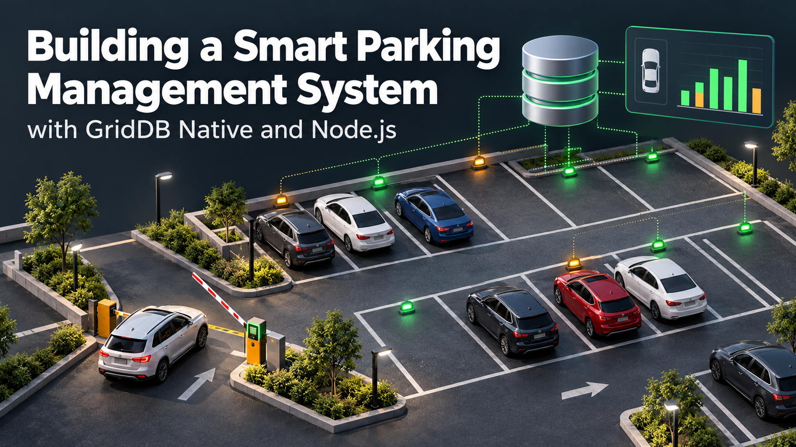
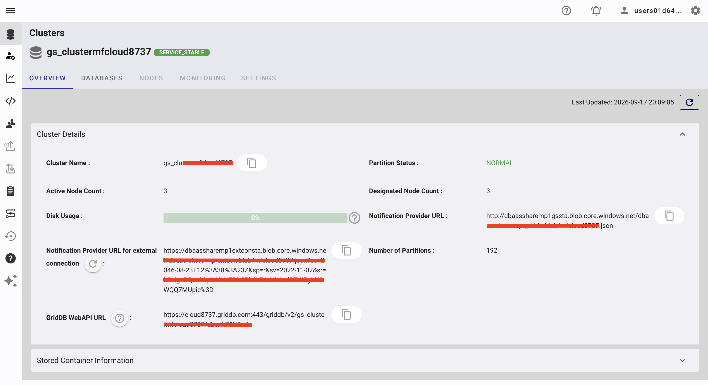
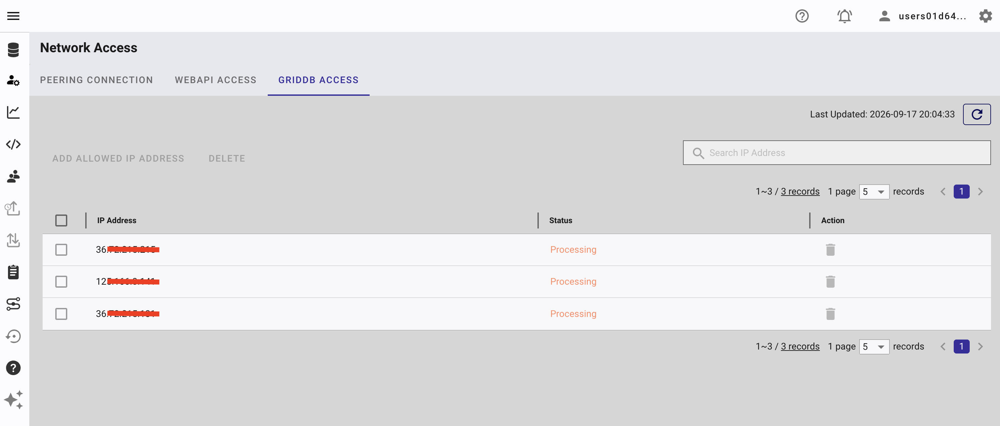
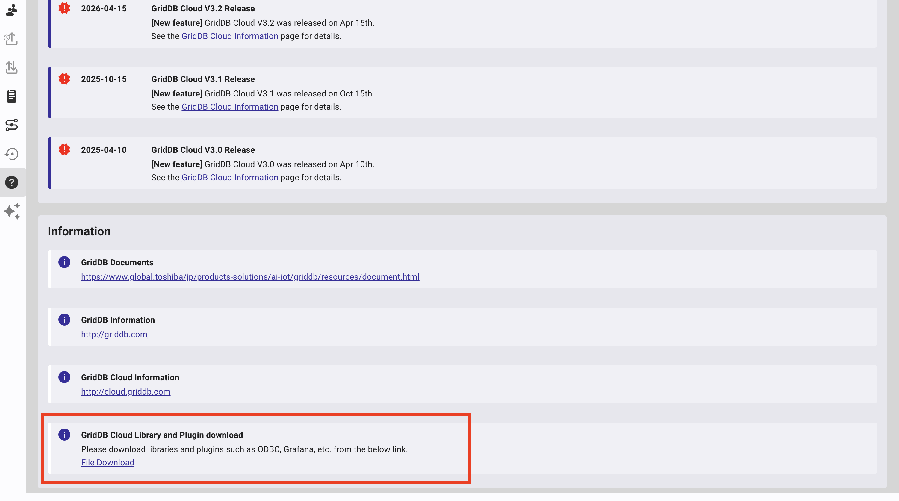
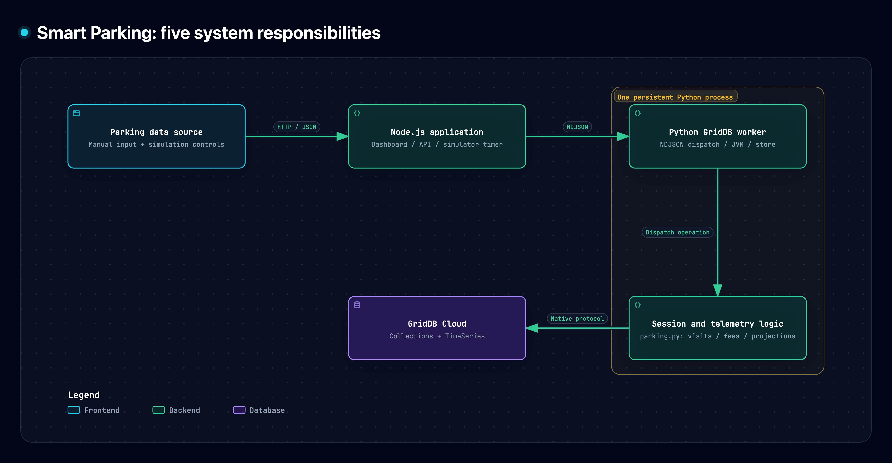
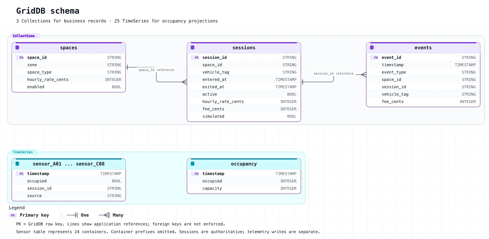
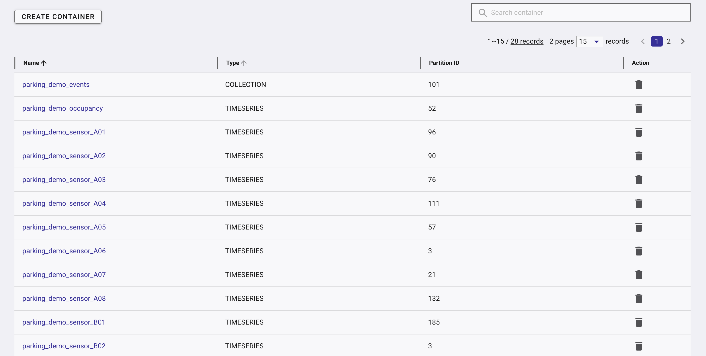
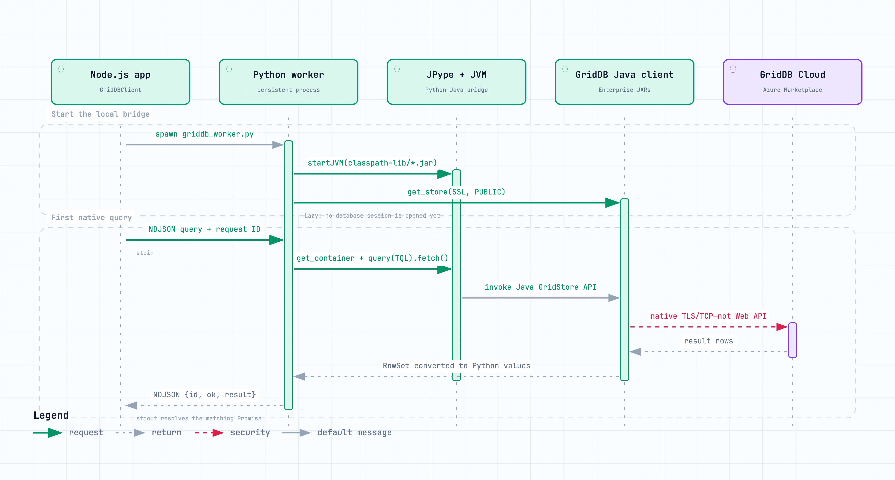
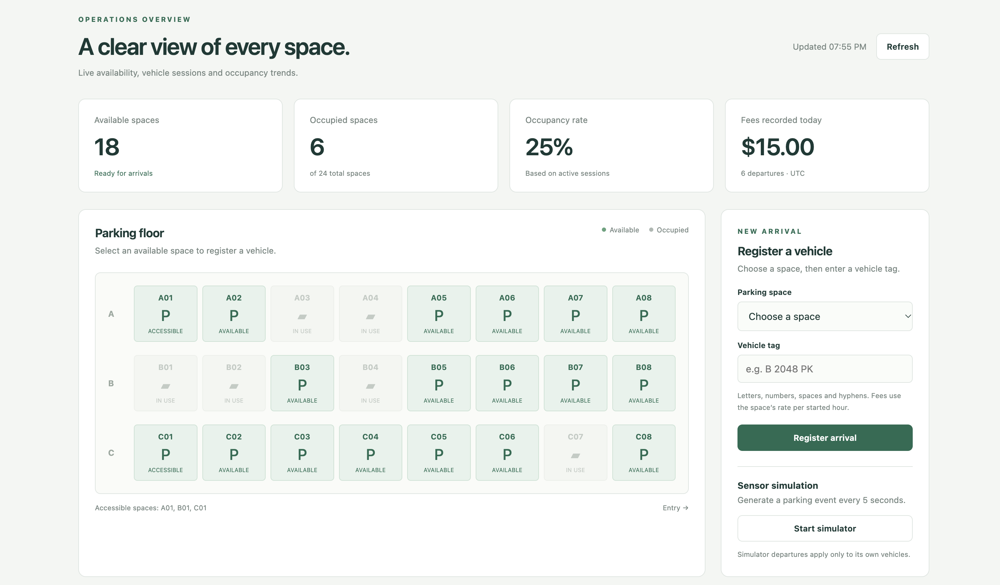

# Building Smart Parking Management System with GridDB Native and Node.js


## Table of Contents

- [What This Blog Is About](#what-this-blog-is-about)
- [What We Will Build](#what-we-will-build)
- [Why Use the Native GridDB Client?](#why-use-the-native-griddb-client)
- [Prerequisites](#prerequisites)
- [How to Run](#how-to-run)
- [System Architecture](#system-architecture)
- [GridDB Schema](#griddb-schema)
- [Technical Implementation](#technical-implementation)
- [Parking Sessions and Fees](#parking-sessions-and-fees)
- [Simulating Parking Activity](#simulating-parking-activity)
- [Reading Results in Node.js](#reading-results-in-nodejs)
- [Connecting Real Parking Sensors](#connecting-real-parking-sensors)
- [What Uses HTTP and What Does Not?](#what-uses-http-and-what-does-not)
- [Testing and Troubleshooting](#testing-and-troubleshooting)
- [Further Enhancements](#further-enhancements)
- [Conclusion](#conclusion)
- [References](#references)

## What This Blog Is About

A parking dashboard needs to answer a few practical questions: Which spaces are available? How long has each vehicle been parked? What fee should be recorded when it leaves? When does the garage reach its busiest period?

In a small lot where every space is visible, a driver can simply park in an empty space. In a garage with several floors or multiple parking areas, finding that space becomes harder. Shared availability information can help drivers decide where to look and give operators a view of how the facility is being used. Sensors supply observations; the useful part is turning parking activity into information people can act on.

In this tutorial, we build a small parking management application with Node.js and GridDB Native. It manages 24 spaces across three zones, records arrivals and departures, calculates fees, and displays occupancy history. A simulator generates parking events, so you can follow along without installing physical parking sensors.

The 24-space layout keeps the example easy to follow. The dashboard is an operator view of the data foundation for smart parking: it shows availability and records how spaces are used. Drivers still choose their own spaces; driver guidance, automatic space recommendations and demand forecasting are possible extensions.

The project includes a browser dashboard, a Node.js API and a persistent Python worker. GridDB Collections store space metadata and sessions, while TimeSeries containers store occupancy samples. The dashboard uses plain JavaScript and CSS, keeping the application easy to inspect and adapt.

## What We Will Build

The prototype has six main features:

1. Manage 24 parking spaces across zones A, B and C.
2. Register arrivals and departures with stable session IDs.
3. Show live availability and active parking sessions.
4. Calculate a fee for each completed visit.
5. Store lot-wide and per-space occupancy samples in GridDB TimeSeries containers.
6. Generate parking activity with a simulator and display its history.

The first version uses simulated input so readers can run it without buying parking sensors. Native mode writes these simulated events into real GridDB containers; the optional demo preview uses memory only.

## Why Use the Native GridDB Client?

GridDB provides both native client interfaces and a Web API. This application uses Node.js to keep its application logic while delegating database operations to the supported Python client.

The native data path is:

```text
Browser → Node.js HTTP API → NDJSON over stdin/stdout
        → persistent Python worker → JPype/JVM
        → GridDB native connection → GridDB Cloud
```

The browser sends HTTP requests to our application. Node.js sends JSON commands to Python, and Python performs database operations using the native GridDB client. These database operations do not use the GridDB Cloud Web API. The Notification Provider URL uses HTTPS for discovery.

The Python worker remains alive for the lifetime of the API process. It owns one GridDB store and handles operations serially. This avoids starting a JVM for every arrival, departure or dashboard refresh. See the official [GridDB Python client](https://github.com/griddb/python_client) and [Cloud public native connection article](https://www.griddb.net/en/blog/connecting-to-griddb-cloud-v3-2-from-your-local-dev-environment-no-vpn-no-vnet-peering/) for the underlying client architecture and route configuration.

## Prerequisites

### Node.js

Install Node.js 22 or newer. This project uses built-in Node modules for the HTTP server, process bridge and tests, with no third-party JavaScript runtime dependencies.

### Python

Use Python 3.12 and a project virtual environment. The native runtime needs the GridDB Python package, JPype and PyArrow. The macOS setup script installs them into `apps/native-bridge/.venv/`.

### Java and Maven

The GridDB Python client invokes the Java API through JPype. The included macOS setup script uses Homebrew to install OpenJDK 21 and Maven, then builds the Arrow adapter.

### GridDB Cloud

Use a GridDB Cloud service with a supported public native route, such as the GridDB Cloud v3.2. From the portal:

1. Generate the Notification Provider URL.
2. Add your application's public outbound IP to the GridDB access list.
3. Download the compatible Cloud Java library bundle from Help, Downloads or Support.
4. Extract `gridstore-advanced.jar` and place it in `apps/native-bridge/lib/`.

The setup script supplies the public libraries; it does not download the licensed Cloud JAR. Keep the JAR and real credentials outside a public repository.


*The cluster overview shows the Notification Provider URL for external connections.*



*Allow your application's public outbound IP under GridDB Access.*



*GridDB Cloud's library download location.*


## How to Run

### 1. Clone the repository and enter the application workspace

The application source are in [junwatu/smart-parking-management](https://github.com/junwatu/smart-parking-management). To clone the project use this command:
```bash
git clone https://github.com/junwatu/smart-parking-management.git
cd smart-parking-management/apps
npm install
```

### 2. Install the public native dependencies

On macOS:

```bash
npm run setup:mac
```

The setup script installs Java and Maven, creates the Python virtual environment, builds the pinned GridDB Python client, and prepares the public runtime JARs. Automated installation is provided for macOS; Linux and Windows require manual installation using the official client instructions.

### 3. Install the GridDB Cloud JAR

Extract the compatible `gridstore-advanced.jar` from the Cloud Java library bundle you downloaded, then copy it into:

```text
native-bridge/lib/gridstore-advanced.jar
```
Or, you can run this script after you extracted the Cloud Java library bundle:

```
cd apps
npm run install:cloud-jar -- "/path/to/griddb-ee-java-lib-5.9.0-linux.x86_64.rpm"
```

The runtime directory should contain these four files:

```text
gridstore.jar
gridstore-arrow.jar
arrow-memory-netty.jar
gridstore-advanced.jar
```

The Cloud JAR contains Java bytecode, while JPype and PyArrow require matching platform and CPU Python packages. This project loads the Java client, so select the Cloud Java library bundle rather than a Web API server package or C client bundle.

### 4. Configure environment variables

From `apps/`, copy the example file:

```bash
cp native-bridge/.env.example native-bridge/.env
```

Fill in your own values:

```dotenv
GRIDDB_NOTIFICATION_PROVIDER='https://your-notification-provider-url'
GRIDDB_CLUSTER_NAME='your-cluster'
GRIDDB_DATABASE='your-database'
GRIDDB_USERNAME='your-user'
GRIDDB_PASSWORD='your-password'
GRIDDB_CONNECTION_ROUTE='PUBLIC'
GRIDDB_SSL_MODE='PREFERRED'
GRIDDB_REQUEST_TIMEOUT_MS='30000'
PARKING_CONTAINER_PREFIX='parking_demo'
PARKING_HOURLY_RATE='2.50'
PARKING_API_HOST='127.0.0.1'
PARKING_API_PORT='3002'
```

Workspace commands load `native-bridge/.env` automatically. Shell environment variables take precedence. Keep the provider URL quoted, do not commit `.env`, and choose a dedicated database or container prefix for this tutorial.

Now check the local runtime:

```bash
npm run doctor
```

Doctor checks configuration and local dependencies. A passing doctor check does not establish that the Cloud database is reachable.

### 5. Initialize the GridDB containers

```bash
npm run init
```

The initializer creates three Collections, one lot-wide TimeSeries and 24 per-space TimeSeries containers. Running it again preserves compatible schemas. An incompatible existing schema stops initialization without deleting its data.

```text
[
  {
    "name": "parking_demo_spaces",
    "status": "created"
  },
  {
    "name": "parking_demo_sessions",
    "status": "created"
  },
  {
    "name": "parking_demo_events",
    "status": "created"
  },
  {
    "name": "parking_demo_occupancy",
    "status": "created"
  },
  {
    "name": "parking_demo_sensor_A01",
    "status": "created"
  },
  {
    "name": "parking_demo_sensor_A02",
    "status": "created"
  },
  ...
]
```
### 6. Seed parking spaces and start the application

```bash
npm run seed
npm run dev:griddb
npm run dev:live
```

Seed adds missing space metadata and preserves existing rates and sessions. `dev:griddb` performs a real database check. The live server also checks connectivity and seeded space metadata before listening.

Open:

```text
http://127.0.0.1:3002
```

Click an available space, enter a vehicle tag, and register an arrival. Register a departure from the active-session table. Start the simulator when you want to generate additional activity; it is stopped by default.

## System Architecture


### Parking data source

Manual arrivals and departures provide the basic input. An optional simulator generates a transition every five seconds. Per-space telemetry is derived from those sessions, providing a reproducible data stream without physical detectors.

### Node.js application

Node.js serves the browser dashboard and parking APIs, validates inputs, starts the worker, matches NDJSON responses to pending requests, and controls the simulator timer. The server uses named parking operations rather than accepting arbitrary TQL or container names from the browser.

### Python GridDB worker

One persistent Python process starts the JVM, loads the JARs and creates the GridDB store. It handles parking operations serially, converting native timestamps and serializing the results as JSON.

### Parking session and telemetry logic

`python/parking.py` checks space availability and active vehicles, creates or closes sessions, calculates final fees, and records event and occupancy projections. Sessions determine live availability. Telemetry describes its history.

### GridDB Cloud

GridDB stores space metadata, sessions, events and occupancy samples. Collections use stable string keys for business records. TimeSeries containers use timestamp keys for recent-window queries.

## GridDB Schema

Parking combines durable business records with time-series occupancy measurements. All container names begin with `PARKING_CONTAINER_PREFIX`; the default prefix is `parking_demo`.

| Container suffix | Type | Purpose |
| --- | --- | --- |
| `spaces` | Collection | Space metadata and rate configuration |
| `sessions` | Collection | Authoritative parking visits and calculated fees |
| `events` | Collection | Arrival/departure audit projection |
| `occupancy` | TimeSeries | Lot-wide occupancy history |
| `sensor_A01` through `sensor_C08` | TimeSeries | Per-space occupancy history |

There are 28 containers in this prototype. The prefix separates the application from unrelated data in the same database.



### `spaces` Collection

| Column | Type | Description |
| --- | --- | --- |
| `space_id` | STRING, row key | Space identifier, such as `A01` |
| `zone` | STRING | Zone A, B or C |
| `space_type` | STRING | `standard` or `accessible` |
| `hourly_rate_cents` | INTEGER | Rate per started hour, in cents |
| `enabled` | BOOL | Whether the space accepts arrivals |

### `sessions` Collection

| Column | Type | Description |
| --- | --- | --- |
| `session_id` | STRING, row key | UUID for one logical visit |
| `space_id` | STRING | Parking-space reference |
| `vehicle_tag` | STRING | Validated vehicle identifier |
| `entered_at` | TIMESTAMP | Arrival time in UTC |
| `exited_at` | TIMESTAMP | Departure time; initially equals arrival time |
| `active` | BOOL | Whether the vehicle is still parked |
| `hourly_rate_cents` | INTEGER | Rate captured for this visit |
| `fee_cents` | INTEGER | Final fee, zero while active |
| `simulated` | BOOL | Whether the simulator created the visit |

The `active` flag identifies unfinished sessions. A completed session stays available for fee reporting and retry handling. UUID keys allow distinct arrivals to occur at the same timestamp.

### `events` Collection

| Column | Type | Description |
| --- | --- | --- |
| `event_id` | STRING, row key | Session UUID plus `arrival` or `departure` |
| `timestamp` | TIMESTAMP | Event time in UTC |
| `event_type` | STRING | Arrival or departure |
| `space_id` | STRING | Parking-space reference |
| `session_id` | STRING | Visit reference |
| `vehicle_tag` | STRING | Vehicle identifier |
| `fee_cents` | INTEGER | Recorded fee for a departure |

Using a Collection avoids timestamp collisions between different vehicles' events. Event IDs also give retries a stable identity.

### `occupancy` TimeSeries

| Column | Type | Description |
| --- | --- | --- |
| `timestamp` | TIMESTAMP, row key | Sample time in UTC |
| `occupied` | INTEGER | Number of active parking sessions |
| `capacity` | INTEGER | Number of enabled spaces |

### `sensor_<space_id>` TimeSeries

| Column | Type | Description |
| --- | --- | --- |
| `timestamp` | TIMESTAMP, row key | Sample time in UTC |
| `occupied` | BOOL | Whether the space has an active session |
| `session_id` | STRING | Active session UUID, or an empty string |
| `source` | STRING | `session_projection` for this simulator |

These rows are projections of session state, not measurements from physical sensors. Sessions remain the authority for live availability and fees. Separate containers keep different spaces' samples from sharing a timestamp key. See the [GridDB data model](https://docs.griddb.net/architecture/data-model.html) for the distinction between Collections and TimeSeries.


## Technical Implementation

### Node.js API Routes

The browser communicates with the HTTP server in `apps/native-bridge/src/server.js`. This server uses Node's built-in `node:http` module to match each request's method and URL path to a parking operation. The same server serves `index.html`, `app.js` and `styles.css` for the dashboard.

| Method | Route | Function |
| --- | --- | --- |
| GET | `/api/health` | Check native database access; demo mode reports that no database is connected |
| GET | `/api/parking` | Return spaces, active sessions, summary statistics and simulator status |
| GET | `/api/events` | Return the newest 100 arrival/departure events |
| GET | `/api/history?hours=24` | Return up to 1,000 recent occupancy samples; `hours` accepts integers from 1 to 168 and defaults to 24 |
| POST | `/api/arrivals` | Register an arrival using `{sessionId, spaceId, vehicleTag}` |
| POST | `/api/departures` | Close a visit using `{sessionId}` and record its final fee |
| POST | `/api/simulator/start` | Start the simulator timer; send an empty JSON object `{}` |
| POST | `/api/simulator/stop` | Stop the simulator timer; send an empty JSON object `{}` |

POST requests require `Content-Type: application/json`. A new arrival returns HTTP 201; a matching arrival retry returns 200. Successful reads, departures and simulator controls return 200. Invalid parking input returns 400, an unknown session returns 404, an occupancy or session-ID conflict returns 409, and native database failures return 503.

To see how an HTTP route reaches GridDB, follow a history request:

```bash
curl 'http://127.0.0.1:3002/api/history?hours=24'
```

Inside the server's request handler, this branch extracts the time window and calls the parking service:

```javascript
else if (req.method === 'GET' && url.pathname === '/api/history') {
  result = await service.history(
    Number(url.searchParams.get('hours') ?? 24)
  );
}
```

`ParkingService.history()` in `src/parking-service.js` validates that window, then calls `this.store.request('history', { hours })`. In native mode, `this.store` is a `GridDBClient`. It sends a command to the persistent Python worker over stdin, with a request ID added by the bridge:

```json
{"id":12,"operation":"history","hours":24}
```

The worker imports `Parking` from `parking.py` and creates `parking = Parking(store)`. Its dispatcher passes the command to the matching method:

```python
elif operation in ("park", "depart", "history"):
    result = getattr(parking, operation)(req)
```

For this request, that call is `parking.history(req)`. The method executes the occupancy TQL query shown later in this article. The worker converts the result to JSON and writes a response to stdout with the same request ID. Node matches that response to its pending promise and sends the result to the browser. The history response contains `points`, `limit` and `possiblyTruncated`.

The simulator start and stop routes control a timer in Node.js. While running, the timer sends `simulate` commands through the same worker. In demo mode, parking operations go to the in-memory store instead of Python or GridDB.

### Starting a persistent Python worker

The Node client in `native-bridge/src/griddb-client.js` starts the worker once. A simplified startup excerpt is:

```javascript
import { spawn } from 'node:child_process';
import { createInterface } from 'node:readline';

const child = spawn(python, [workerPath], {
  env: workerEnvironment(),
  stdio: ['pipe', 'pipe', 'inherit'],
});

const lines = createInterface({ input: child.stdout });
lines.on('line', line => {
  const response = JSON.parse(line);
  // Match response.id to the pending promise in the complete client.
});
```

The complete implementation runs this startup logic inside the client constructor. It defines `python`, `workerPath`, `workerEnvironment` and the response handler in that module, and also handles invalid responses and worker failures. Each command occupies one JSON line:

```json
{"id":12,"operation":"health"}
```

The worker returns the same ID:

```json
{"id":12,"ok":true,"result":{"status":"ok","mode":"native","database":"reachable"}}
```

Request IDs match responses with pending Node promises. The Python loop still executes one database operation at a time. The client also supplies the Java Arrow memory-access option, detects worker failure and terminates a worker after a request timeout.

### Loading the GridDB runtime

The worker collects the JARs from `lib/` and starts JPype before importing GridDB:

```python
lib = Path(__file__).resolve().parents[1] / "lib"
if not jpype.isJVMStarted():
    jpype.startJVM(
        classpath=[str(path) for path in sorted(lib.glob("*.jar"))]
    )

import griddb_python as griddb
```

The complete worker checks that all four required JARs exist before starting the JVM. It writes JSON responses to stdout and startup diagnostics to stderr, keeping the NDJSON stream valid.

### Connecting to GridDB Cloud

The store uses environment values and an optional route:

```python
options = {
    "notification_provider": os.environ["GRIDDB_NOTIFICATION_PROVIDER"],
    "cluster_name": os.environ["GRIDDB_CLUSTER_NAME"],
    "database": os.environ["GRIDDB_DATABASE"],
    "username": os.environ["GRIDDB_USERNAME"],
    "password": os.environ["GRIDDB_PASSWORD"],
    "ssl_mode": os.environ.get("GRIDDB_SSL_MODE", "PREFERRED"),
}
route = os.environ.get("GRIDDB_CONNECTION_ROUTE", "PUBLIC").strip()
if route:
    options["connection_route"] = route
store = griddb.StoreFactory.get_instance().get_store(**options)
```

Use uppercase `PUBLIC` for the public native route. An empty route omits the option and requires the appropriate private network configuration. This worker still requires a Notification Provider URL in either case.

Store creation is lazy. The `health` operation accesses the spaces container to force an actual native request rather than relying on worker readiness.



*The shared native-client bridge pattern: Node.js sends NDJSON to a persistent Python worker, which calls GridDB through JPype and the Java client. This is an explanatory diagram, not evidence of a live parking Cloud run.*

### Creating a TimeSeries container

The schema initializer describes the lot-wide sample explicitly:

```python
info = griddb.ContainerInfo(
    "parking_demo_occupancy",
    [
        ["timestamp", griddb.Type.TIMESTAMP],
        ["occupied", griddb.Type.INTEGER],
        ["capacity", griddb.Type.INTEGER],
    ],
    type=griddb.ContainerType.TIME_SERIES,
    row_key=True,
)
container = store.put_container(info, modifiable=False)
container.close()
```

The complete initializer checks existing containers first and compares their type, row-key assignment and columns. It refuses to alter incompatible schemas.

### Registering an arrival

The browser creates a UUID for each logical arrival and submits it with the selected space and vehicle tag. The Node service validates the request and sends a domain command to the worker:

```javascript
const result = await client.request('park', {
  sessionId,
  spaceId: 'A01',
  vehicleTag: 'B 2048 PK',
});
```

The worker checks whether that session already exists, whether the space is available, and whether the vehicle already has an active session. It then writes the session, records an arrival event, and samples occupancy.

The session is the authoritative record. If an event or telemetry projection fails after the session is saved, the API returns the session with a warning. The separate writes are not one atomic transaction across containers. A production application should reconcile missing projections from the session records.

An HTTP arrival looks like this:

```bash
curl -X POST http://127.0.0.1:3002/api/arrivals \
  -H 'Content-Type: application/json' \
  -d '{"sessionId":"5b5207cb-92ab-491e-b410-132535258ba1","spaceId":"A01","vehicleTag":"B 2048 PK"}'
```

Repeat the same request to retry the same arrival. A matching retry returns the existing session. Use a new UUID for a new visit. A different vehicle trying to use an occupied space receives HTTP 409.

### Writing occupancy samples

Inside `Parking.record_telemetry`, the worker derives occupancy from active sessions and writes both lot-wide and per-space samples:

```python
self.put("occupancy", [timestamp, len(active), capacity])
for row in metadata:
    self.put(
        f"sensor_{row[0]}",
        [timestamp, row[0] in by_space,
         by_space.get(row[0], ""), "session_projection"],
    )
```

Here `self.put` resolves the configured prefix and writes a typed row through the native client. `timestamp` is a UTC Python datetime. The worker gives successive samples distinct millisecond timestamps to avoid overwriting two transitions within one millisecond during the same worker run.

### Querying occupancy history

The dashboard requests a bounded time window through `/api/history?hours=24`. The worker uses TQL against the occupancy container:

```sql
SELECT *
WHERE timestamp > TIMESTAMPADD(HOUR, NOW(), -24)
ORDER BY timestamp DESC
LIMIT 1000
```
The application reverses the newest rows before drawing the chart. Keeping the query bounded prevents the worker from loading an unlimited history into memory. The response indicates when the limit may have truncated the requested period.

History starts when the application records activity. The seed command does not create fictional past observations. Run the simulator or register vehicles to build a useful chart.

## Parking Sessions and Fees

A departure references the session ID. The worker records the exit time, marks the session inactive, calculates the fee and writes a departure event.

This example charges per started hour and stores money as integer cents:

```python
def fee_cents(entered, exited, rate):
    seconds = max(0, (exited - entered).total_seconds())
    return math.ceil(seconds / 3600) * rate
```

At $2.50 per hour, a session lasting exactly one hour costs $2.50. One hour and one second costs $5.00. A repeated departure returns the already completed session without adding another fee.

The dashboard shows an estimated fee while the vehicle is parked. Final fees are recorded when the departure completes. This is a billing demonstration, not a payment integration. The daily fee summary uses departures since midnight UTC and flags partial totals when the bounded query exceeds 5,000 completed sessions.

All native timestamps are Python datetimes. GridDB may return naive UTC datetimes; the worker explicitly attaches UTC before arithmetic and before rewriting the row. Passing an ISO timestamp string to an untyped generic `put` would miss this conversion.

## Simulating Parking Activity

Click **Start simulator** to generate one parking transition every five seconds. It chooses an available space for an arrival or closes one of its simulated sessions. It never selects a manually registered session for a simulated departure.

In native mode, these events are written to GridDB using the configured prefix. The simulator stops after an error and exposes the reason in the dashboard. Click **Stop simulator** when you want to return to manual operations.

## Reading Results in Node.js

Node.js asks the worker for a parking snapshot, recent events and bounded history. The worker returns named fields rather than exposing raw GridDB row positions to the browser:

```javascript
const parking = await client.request('snapshot');
const events = await client.request('events');
const history = await client.request('history', { hours: 24 });

console.log(parking.stats.available);
console.log(parking.stats.occupancyPercent);
console.log(parking.stats.revenueTodayCents / 100);
console.log(history.points);
```

The API exposes these through `/api/parking`, `/api/events` and `/api/history`. Browser requests execute sequentially to avoid repeatedly building a queue in the synchronous worker.

The dashboard shows:

- Available and occupied space counts.
- A floor map with three zones and accessible-space labels.
- Active vehicles, entry times, durations and estimated fees.
- Fees recorded for completed sessions since midnight UTC.
- Recent arrival/departure activity.
- Occupancy history and simulator status.

Rates are captured in each session so an existing visit retains its original rate. Completed fee totals are bounded to 5,000 visits per UTC day and expose a truncation flag if that limit is exceeded.



## Connecting Real Parking Sensors

A physical parking installation could use ultrasonic or magnetic occupancy detectors, a gate controller, or a license-plate recognition system. Each has a different role: a detector measures occupancy, while a gate event helps identify a vehicle visit.

A future adapter could use this path:

```text
Parking detector → MQTT → Node ingestion adapter
                 → typed Python worker operation → GridDB TimeSeries
```

This project doesn't include an MQTT subscriber or an external sensor-ingestion endpoint. Adding one requires validated space IDs, timestamps converted to UTC datetimes, duplicate-message handling, and a policy for delayed readings.

Keep observed sensor state separate from session state. If a detector says a space is occupied but there is no active session, flag the disagreement for reconciliation rather than silently creating a billable visit. Similarly, a single noisy vacant reading should not automatically close a paid session.

Reservations, accessible-space eligibility and payment authorization are separate business rules that can be added once the basic session flow is reliable.

## What Uses HTTP and What Does Not?

| Connection | Transport | Purpose |
| --- | --- | --- |
| Browser → Node.js | Local HTTP | Dashboard, arrivals, departures and history |
| Node.js → Python | NDJSON over process stdin/stdout | Named application commands and responses |
| Native client → Notification Provider | HTTPS | Discover Cloud connection information |
| Native client → GridDB Cloud | Native database protocol, with Cloud SSL configuration | Schema creation, row reads/writes and TQL queries |

The local HTTP endpoints are application APIs. They do not forward operations to the GridDB Cloud Web API. The native Python/JVM client performs the database work, and GridDB credentials remain in the server environment.

The default server binds to `127.0.0.1`. A public deployment needs HTTPS and operator authentication before exposing arrival, departure or simulator controls.

## Testing

Run the offline checks from `apps/`:

```bash
npm run check
npm test
cd native-bridge/python
python3 -m unittest -v test_parking.py
```

The tests exercise fee boundaries, repeated requests, occupancy conflicts, duplicate vehicles, input validation, HTTP endpoints, simulator controls, timestamp normalization and projection failures. They also check that seeding preserves existing data.

For native verification, repeat schema initialization, confirm the containers remain unchanged, start the API, register a vehicle, close its session and check the history after several simulator events. The offline tests and successful JVM schema construction do not establish Cloud connectivity by themselves.

## Further Enhancements

1. Add validated MQTT or gate-controller ingestion for physical hardware.
2. Reconcile observed occupancy with session state and repair missing event/telemetry projections.
3. Support reservations, accessible-space eligibility rules and temporarily disabled spaces.
4. Introduce tariff schedules, discounts and grace periods while preserving each visit's applied rate.
5. Integrate a payment provider and distinguish calculated fees from settled payments.
6. Add operator authentication, role-based access and auditable administrative actions.
7. Add retention or archival rules for high-frequency occupancy samples.
8. Add capacity alerts and richer occupancy analysis from stored history.
9. Design database-supported coordination before running multiple API processes against the same spaces.
10. Document and automate deployment for each target platform.

The project demo in this blog don't include occupancy forecasting. A future forecast needs enough observed history and an evaluation method before its predictions should influence reservations or capacity planning.

## Conclusion

This application connects Node.js to GridDB Native through a persistent Python worker and combines parking-session records with occupancy history. Collections provide stable identities for spaces and visits, while TimeSeries containers make recent occupancy easy to retrieve and visualize. The supplied simulator lets readers explore the complete flow before connecting physical sensors.

## References

- [GridDB Python client source](https://github.com/griddb/python_client)
- [GridDB Python getting started](https://docs.griddb.net/gettingstarted/python.html)
- [GridDB Cloud public native connection](https://www.griddb.net/en/blog/connecting-to-griddb-cloud-v3-2-from-your-local-dev-environment-no-vpn-no-vnet-peering/)
- [GridDB data model](https://docs.griddb.net/architecture/data-model.html)
- [GridDB TQL reference](https://docs.griddb.net/tqlreference/)
